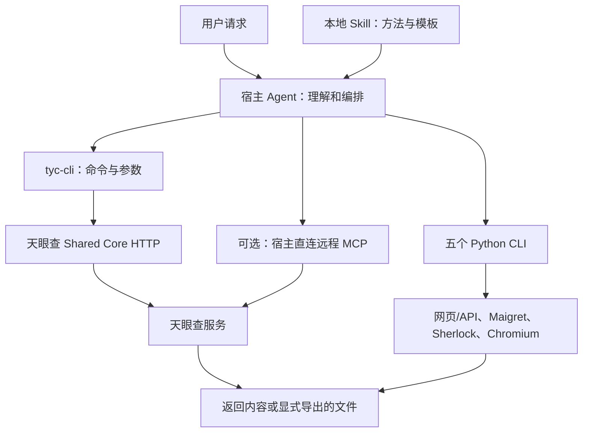
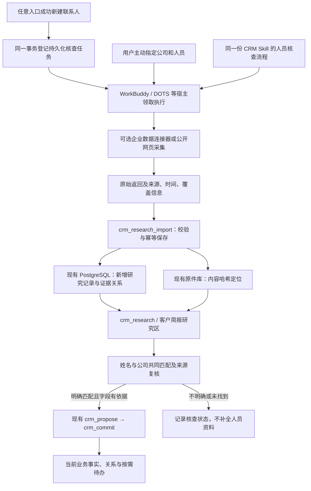

# SeekingPerson 审查与 Agent CRM 整合方案

日期：2026-10-29。状态：**审查与设计完成，整合尚未实施**。范围已按用户更正更新为“每位新增联系人的初步核查＋主动指定公司人员调研”；撤销此前误选的“寻找新客户和业务关键人”。

## 1. 结论与建议范围

可以整合。推荐把 SeekingPerson 提炼为 Agent CRM 的**联系人初步核查与主动调研能力**：以姓名和公司共同核对人员身份，整理有明确依据的初步职业信息。Agent CRM 继续管理客户沟通、项目、事实、证据、历史和待办，宿主 Agent 负责理解与判断，无须为 CRM 再配置一套聊天模型。企业查询提供方可以替换或停用；新增人员的核查状态和已保存证据不依赖某一个提供方。

第一版明确包含两种入口：

1. **新增联系人后核查**：每位实际新建的联系人登记一次初步核查，按“姓名＋明确公司主体”查找公开职业资料。能清晰对应才采用相应信息；无法对应、同名难以排除或资料互相冲突时不补全档案。
2. **主动指定调研**：用户说“帮我调研某公司的某某某”时直接使用同一流程。可以在不新建 CRM 联系人的情况下先调研；用户要求归档时再关联已有档案或按正常录入创建，不能为每次搜索自动建人。

核心采用规则是：**联合公司信息检索不到，或关联不清晰、不明确，就不用该外部数据补全这个人的档案。** 信息不足时给出“未找到明确匹配”或“身份关联不明确”，不猜测其职务、联系方式、采购权限或关系。不把缺少外部结果解释为这个人或公司不存在；也不撤销用户已提供的真实沟通信息。

暂不接入跨平台私人账号关联、QQ 号段估算、头像身份推断、个人位置轨迹、转账查姓名等流程。它们对当前销售资料闭环帮助有限，且本次发现的实现错误较多。也不全量安装 50 份 Skill 或另建一套 CRM。

批量找新客户、名单挖掘、供应商全面核查和持续监控不作为第一版目标。此次更正明确了业务范围，不代表已经部署自动核查，或授权付费、新服务上传与对外联系。

## 2. 审查对象与验证边界

审查对象为用户提供的 `SeekingPerson.zip` 源码归档，不是独立运行中的 CRM。原始归档和审查副本不随本源码包分发。

| 项目 | 本次确认内容 |
|---|---|
| 原始压缩包 | 121,255,172 字节；未修改 |
| SHA256 | `97c182cfe5a2d49fc5faac9d651b02631c1cdc02668cf4f32ad672bc085c1df1` |
| 实际项目源文件 | 排除依赖、系统元文件后 79 个文件 |
| Skill | 49 份天眼查场景 Skill＋1 份 Chinese OSINT Skill |
| 包内工具脚本 | 5 个独立 Python CLI；Node 根项目仅包装 `tyc-cli` 命令 |
| 打包的天眼查 CLI | `tyc-cli@0.3.10`；本地 catalog 含 162 个业务工具定义 |
| 携带环境 | macOS Python 3.11 `.venv`、Node 依赖与浏览器等；不能作为 Linux/Windows 通用运行环境直接搬运 |

本次检查代码、依赖实现、配置结构和文档，进行了断网 CLI 冒烟与合成数据模拟测试。没有执行安装脚本、启动原包虚拟环境、读取用户实际登录配置、查询真实公司或个人、调用付费接口，也没有改动 CRM 的客户数据。

原作者 `state.md`、`report.md` 中的测试记录仅作为历史说明。本次没有验证天眼查账号权益、OAuth 登录、远端 MCP 握手、真实返回准确性、宿主实接或 Windows 运行。现有 CRM 的说明以当前代码和测试记录为据，本轮未重新运行其全套测试。

原审查时基线为0.1.3；分享整理时基线已为0.1.4，含可选产品资料库。后续增量实施须从实际当前版本开始，并避开已有迁移号；不能按本方案示意覆盖已实现功能。

## 3. SeekingPerson 实际架构

```text
SeekingPerson/
├── foundation.md、state.md、report.md      项目约定、状态与历史报告
├── docs/decisions/、docs/learnings/        技术决定与问题记录
├── package.json、package-lock.json         Node 入口；依赖 tyc-cli
├── requirements.txt                        Python 依赖下限，未锁定完整版本
├── .mcp.json                               天眼查远程 MCP 地址配置
└── .agents/
    ├── skills.json                         本地 Skill 目录索引
    ├── plugins/tyc-skills/                 MCP 地址与插件描述
    ├── references/tyc-mcp-skills/           上游使用说明
    └── skills/
        ├── tyc-*/SKILL.md                  49 个场景编排与报告模板
        └── chinese-osint/
            ├── SKILL.md、AGENTS.md 等      检索方法说明
            ├── install.sh                 安装器；本次语法检查失败
            └── scripts/
                ├── cross_platform_search.py
                ├── qq_avatar.py
                ├── qq_info.py
                ├── weibo_scraper.py
                └── avatar_analysis.py
```



实际职责边界：

- **Skill 是流程说明**，不是执行引擎、权限系统或持久数据库。项目没有自身的应用后端、业务表、迁移、客户档案服务或可靠调度器。
- **天眼查 CLI 是 HTTP 客户端**。本地 catalog 用于生成命令；业务调用 POST 到 `/v1/core/tools/call`。它不是本地 MCP stdio 服务端。根 `.mcp.json` 则是另一条“宿主直连远程 MCP”的配置路径，配置存在不等于连接成功。
- **Python 部分是零散采集器**：用户名搜索、QQ 资料/头像、微博页面响应收集、头像像素规则分析。若干 README 能力只存在于方法说明中，没有对应的完整实现或本次运行证据。
- **结果没有业务持久化闭环**。CLI 默认输出，显式 `--output-file` 可保存 JSON/Markdown，但没有 CRM 所需的客户关联、来源版本、冲突处理和待办维护。生成报告不等于保存原始证据。
- **项目没有独立模型配置**，主要依赖宿主推理。第三方服务器内部的数据处理与保留策略不能从本地代码确定，接入前仍需核对。

天眼查当前官方仓库说明，远程 MCP 的 `tools/list` 默认仅公开少量入口；162 是更深层业务能力，CLI 使用打包 catalog。未来适配器应发现实际能力并校验参数，不假设所有旧名称都直接暴露。[官方 CLI 文档](https://github.com/tyc-tech/tyc-cli)、[官方接入说明](https://www.tianyancha.com/ai/skills/skill.md)。

## 4. 已验证内容与主要问题

| 验证项 | 本次结果 | 能说明什么 |
|---|---|---|
| CLI `--version` | 通过，0.3.10 | 打包命令在隔离环境可启动 |
| CLI `layers --json` | 通过，162 项；L0/L1/L2/L3 为 1/6/57/98 | 本地能力目录可读，不证明账号可调用 |
| CLI L0 工具发现 | 通过，企业搜索定义可读 | 可发现搜索参数，不证明真实搜索可用 |
| 5 个 Python 文件 AST 语法 | 全部通过 | 仅证明可以解析 |
| `bash -n install.sh` | 失败，退出码 2 | 安装器当前不能正常解析执行 |
| 5 个离线模拟探针 | 均复现错误行为 | 见下表；尚未修复 |
| 真实天眼查/社交平台查询 | 未执行 | 不能承诺准确性、权益、额度或成本 |
| CRM 研究入库、重启与迁移 | 尚无实现 | 属于后续验收范围 |

优先问题：

| 优先级 | 问题与证据位置 | 整合处理 |
|---|---|---|
| P0 | `chinese-osint/install.sh:62` 引号错误；还会克隆未固定版本的远端代码、覆盖已有配置并吞掉错误 | 不执行或迁入该安装器；沿用 CRM 安装与接管流程 |
| P0 | `weibo_scraper.py:59–99` 不限定目标 UID，模拟首页其他人的帖子进入目标结果 | 不能用现脚本产生联系人事实；第一版排除该采集路径 |
| P0 | `cross_platform_search.py:50–69` 将 B 站被阻止响应变成“未找到”；`:122–128` 将两条 Sherlock 结果覆盖成一条 | 错误、受限、空结果、部分结果分别表达；如以后采用须重写解析和契约测试 |
| P0 | 企业主体会按存续状态/注册资本过滤排序，甚至单候选自动选定；完整公司名也可能跳过核对 | 不按同名、同音、最大资本或仅一个候选自动关联 |
| P0 | 外部返回没有证据、历史与纠错链 | 在研究区保存来源和候选发现，禁止直接覆盖当前业务事实 |
| P1 | CLI `dist/config.js:15–16`、`oauthPending.js:9–10` 固定使用 `~/.tyc/` | 目录迁移不包含登录状态；采用宿主凭据管理或经验证的显式配置目录适配 |
| P1 | Skill 参数存在语义漂移：`tyc-profile/SKILL.md:57–61` 把企业主体交给实际要求品牌 ID 的标签查询 | 精选接口逐项验证；不要原样导入所有 Skill |
| P1 | `cross_platform_search.py:22–34` 将 HTTP 200 的非图片内容误作账号存在；`qq_info.py:53–77` 给字母串生成注册年份 | 不纳入初版；这些输出不作为身份或时间证据 |
| P1 | Python 依赖仅下限约束；临时文件复用、进程状态及请求边界不足 | 可选连接器单独锁版本、限时限量、隔离输出与测试 |
| P1 | 包内顶层与 49 份天眼查 Skill 未附明确许可 | 复制发布前补齐来源、版本和许可；优先自行编写精简集成流程 |

上述行号相对本次抽取的 `source/.agents/skills/` 或 `dependency-source/tyc-cli/`。头像分析的 confidence 是规则分数占比，不是经过校准的身份概率。昵称、头像或“企业名＋人名”都不单独证明是 CRM 中的同一个人。

审查使用了本地能力发现及全模拟网络/浏览器依赖的离线探针。原始审查副本与机器专属路径私有保留，不属于分享包；本文件保留可复核的代码位置、验证边界与缺陷摘要。

## 5. 推荐整合架构



核心仍是 [现有架构](ARCHITECTURE.md) 中的领域服务，HTTP、MCP、CLI 共用规则。研究导入自身不联网、不调用模型；外部调用在可选连接器或具备工具的宿主执行。宿主更换不要求重建研究历史，也不要求安装全部 Python 工具。

**新增必核查不等于后台已能自动运行模型。** 为覆盖管理台手工新增、CLI、MCP 和材料归档中创建的联系人，领域服务应在成功提交新 contact 的同一数据库事务内登记核查任务，而非仅依赖宿主记住去做。宿主正在录入时可立即领取；宿主不在线、资料缺少公司或连接器不可用时持久保存待核查/受阻状态，下一次宿主接入时继续。没有持续运行的宿主执行器时，不能承诺无人在线也会即时完成。

核查任务按稳定联系人 ID、身份信息修订和流程版本去重。普通重复上传或修改无关字段不重复查询；公司或姓名被纠正后，旧核查失效并按新身份重新核查。任务使用租约与有限重试，重启不丢失、不重复提交；没有结果或身份不明确时本次核查结束，不自动无限轮询。已有联系人批量补查不在本轮执行。

采用信息必须同时满足：

- 公司主体能明确对应；简称、品牌和法律主体尚未分清时先保留未知。
- 来源明确将该姓名与这家公司及相关职业信息联系起来；搜索摘要、同音、头像、电话号码相似或一次单候选均不够。
- 没有未解决的同公司同名人员、曾任/现任时间或实体归属冲突；旧任职信息只按历史信息表达。
- 每个拟采用字段都有对应来源。匹配到本人不意味着同一页面的所有推测都可采用；公开职务也不等于其在本项目的采购职责。

未通过上述门槛的人员属性不进入当前联系人画像、经营简报结论、关系或待办。核查区仅保留说明“为何未采用”所需的状态、范围与来源线索，确需留存的响应证据单独作为未采用材料，不扩展成疑似人员画像，也不因未采用去删除已有历史。明确匹配后的资料仍标为外部来源说法，不能自动升级为已核验事实。

来源边界必须准确：

- 能取得上游原始 JSON/页面时保存完整取得内容；MCP 只能取得工具返回时，保存该返回并标明“工具响应快照”。不能把它冒充上游完整 HTTP 响应或原始数据库记录。
- 保存调用层、提供方、工具名/版本、脱敏参数、完整已取得返回、来源 URL/记录 ID、源时间、抓取时间，以及分页、截断和权限限制。只保存链接不足以复核历史。
- 原始快照进入既有 `.local/data/objects/<sha256>`，结构化元数据、发现与关联进入同一 PostgreSQL；单文件仍为 500,000,000 字节上限。过大的集合应分页分件，不静默截断。
- 生成摘要/拜访报告是派生结果，需要留存时另作材料，关联本次 run、发现与来源；不替代原始快照。未保存时不能声称报告已经归档。
- 外部材料始终作为数据处理，其中的指令不能触发执行代码、外发、购买、权限变更或提醒。

### 5.1 最小数据结构（拟新增）

不另建数据库；在现有 `portable_crm` schema 内新增以下五类记录，复用现有材料、证据、审计和稳定 ID。与初稿相比增加持久化核查队列，以覆盖“每位新增人员都要过一遍”。

| 表 | 主要内容 |
|---|---|
| `research_jobs` | 联系人稳定 ID、姓名/公司身份修订、触发入口、流程版本、幂等键、排队/租约/受阻状态、重试次数、结果 run；与联系人创建同事务登记 |
| `research_runs` | 研究目的、候选/已确认对象、提供方、脱敏查询参数、工具版本、执行者、幂等键、起止时间、状态、分页覆盖、错误、费用/额度元数据 |
| `research_sources` | run、material ID、外部记录 ID、来源 URL/标题、源发布日期/更新时间、获取时间、取得层级（如 `mcp_tool_result` / `upstream_http_body` / `web_capture` / `user_upload`）、可用范围/许可说明 |
| `research_findings` | run、候选主体、导入时身份映射版本与归属、发现类型与值、`external_reported`/`inference`/`suggestion` 分类、有效时间、争议/被替代/撤回状态、前次发现引用、版本及关联证据 |
| `external_identities` | CRM 实体、提供方与对象类型、外部 ID/统一社会信用代码、候选/确认状态、确认人、依据、原因与版本历史 |

研究批次另记 `match_status`（明确对应/不明确/未找到/输入不足）及逐条 `adoption_status`（未采用/可采用/已采用/待复核），将执行成功、身份匹配和资料采用分开。租约、结果与状态转换由服务校验；一次外部 HTTP 成功不能将任务直接标成资料核验通过。

同一个研究输出重导不重复建 run、发现或待办；同样查询在不同时间刷新应产生新 run。相同字节可以复用原件，但每次获取时间和覆盖仍分别保留。一个发现可链接多个证据，多来源冲突不能用“最后写入”覆盖。前后发现通过 `supersedes_id` 等引用串联，纠错审计保留前后值、理由和依据，不能只保留一个 version 数字。某条风险不再返回，不自动推定已经解除。

身份处理规则：

- CRM 的“客户业务账户/品牌”不一定等于某个法律主体；可关联独立 organization 实体，表达法律主体、最终业主、供应商等角色，不能自动改客户名称或合并实体。
- USCC、提供方企业 ID 与来源共同用于核对。只有名称或搜索唯一候选时仍可保持未确认，不强行补齐。
- 联系人的公开任职关系与我们沟通中负责的事项分别保存；法人、股东或高管不自动成为采购决策人。
- 更正外部身份映射保留前后版本及依据，历史快照不改写；当前检索撤销错误关联，受影响发现标为待复核，已进入业务事实或待办的内容通过现有纠错流程处理。返回影响范围，尚未处理完的复杂纠正显示 `pending`，不能只改映射就声称全部修复。

### 5.2 事实可信度与查询状态

当前 CRM 只有 `user_provided`、`customer_claim`、`verified`、`inference`、`suggestion` 五类业务事实。文本引文校验只证明“引文存在于原文”，不会自动证明来源属实、主体匹配或信息仍有效。writer 有权导入不代表收到的材料确由其声明提供方出具；导入须记录采集方式，服务端不能允许借 import 自行标为已审核或已核验。

所以第一版 `external_reported` **仅存在于新增研究层**，不擅改现有事实分类约束，不把平台返回塞成客户自述或用户提供。外部发现通常保留在研究区；确需形成业务事实时，经过身份与来源复核，再按真实性质通过既有提议/提交工具保存。未核验内容不能因为有引文就升级为 `verified`。

例如：

- 注册资本不是营业收入，公开招标不是我们的订单。
- 平台显示某企业是另一企业供应商，不等于用户实际与其合作。
- 风险记录不直接等于当前交易不可进行；风险总数也不代表全部仍有效。
- 查到一名高管不等于确认其采购权限，未查询的维度不能填成“无风险”。

执行状态至少区分成功、部分完成、无结果、需要登录、无权限、额度不足、被阻止、超时和失败；“无结果”仍须附覆盖范围。源资料时间未知就明确未知，不能用抓取时间代替事件发生时间。

### 5.3 工具与界面（拟新增）

增加四个领域入口，并由现有 MCP/CLI/HTTP 暴露：

| 工具 | 权限 | 职责 |
|---|---|---|
| `crm_research_next` | writer | 为宿主领取一项待核查任务与租约；缺少输入/授权时不发起外部查询。结果导入关联 job，完成或受阻状态原子更新；租约过期可安全续处理 |
| `crm_research_import` | writer | 导入宿主已取得的来源、快照、发现和覆盖情况；校验/幂等/留痕，不自动提交业务事实 |
| `crm_research` | reader | 按客户/组织/外部身份、类型、日期读取当前与历史研究，返回证据、时效和缺失 |
| `crm_identity_link` | owner | 在用户确认后建立或纠正主体映射；强制依据、原因、当前版本和审计 |

联系人详情展示“待核查/核查中/缺公司信息/未找到明确匹配/关联不明确/已整理/查询受阻”等状态和最近核查时间。用户主动调研可以先按“公司＋姓名”建立独立 run，不要求联系人 ID，也不自动创建客户或人员。

`crm_customer` 增加独立 `externalResearch` 区块，客户页增加“外部研究”入口，展示研究时间、来源、已通过采用门槛的发现及未覆盖项。歧义候选仅在专门核查详情展示，不混入客户简报或被当作该联系人的真实属性。默认客户简报区分“我们沟通中已知”和“外部资料显示”。研究建议只有用户要求跟进时才进入既有待办流程，不自动产生反复提醒。

外部接口优先支持公司主体核对、指定公司内的人员检索与公开职业资料；按需补公司官网、公告和职业介绍。天眼查主要人员名录未覆盖普通业务人员时，不能据此判定此人不存在或没有任职。远程 MCP 与 CLI 参数可能不同，必须分别做契约测试；不把 REST 地址写成 MCP stdio 配置，也不硬编码旧的 49 场景流程。

### 5.4 检索与向量

这次企业数据接入不需要独立向量数据库：先用实体稳定 ID、USCC、来源、日期、发现类型及结构字段查询即可。原始报告正文的中文全文检索与可选本地 embedding 继续按 [项目方案](PROJECT_PLAN.md) 实施。未来向量只作召回辅助，不能用相似度确认公司/人员身份或替代证据。

## 6. 复用、改造与舍弃清单

| 内容 | 处理 |
|---|---|
| 按问题分层查询、先锚定主体再下钻 | 复用思想；改写为 CRM 的精简研究流程 |
| 企业主体核对、指定人员公开职业信息 | 第一批精选接口；重点检验姓名与公司联合匹配 |
| 经营、供应链、客户名单发现 | 按后续明确需求接入，不作为新增人员必查内容 |
| 报告模板、覆盖缺失说明 | 提炼；每条重要结论补来源，不生成无依据评分 |
| 天眼查 CLI / 远端 MCP | 作为可选提供方；先验证账号、接口、预算和宿主实际可用性 |
| 原始结果、身份候选和刷新历史 | SeekingPerson 未实现；在 CRM 新增研究层 |
| 49 个天眼查 Skill、原项目 AGENTS/CLAUDE | 不整体复制进 CRM；避免重复指令、过时参数和覆盖宿主规则 |
| 原安装器、macOS `.venv`、浏览器与缓存 | 不迁入默认运行时；依赖按目标系统重装并锁版本 |
| QQ/头像/私人社交足迹工具 | 初版不接入；不影响企业研究闭环 |
| 新 CRM、第二套模型、独立向量服务 | 本次不引入 |

## 7. 数据流向、费用、凭据与许可

**外发最小化。** 外部查询通常只需要企业名称/USCC 或已确认的公开商业角色条件，不应连带上传客户聊天、报价、技术资料和整份档案。宿主模型接收什么内容仍取决于宿主配置；本地落库不等于所有分析在本机完成。首次把真实客户标识交给新的提供方、付费查询或扩大权限前，按现有授权规则另行确认。

**成本可见。** 本地 catalog 的套餐标签不能代表当前价格、会员权益或余额。OAuth 登录成功也不代表能访问所有商业数据。连接器需提供工具白名单、页数/数量/调用上限、超时、取消、重复调用缓存和可见的调用记录；缓存重用应显示原查询时间。只有提供方返回了实际费用/额度信息才记录确定值，未知则留空。不要把 HTTP 成功自动等同查询免费。

**凭据单独管理。** 当前 CLI 的 `~/.tyc/config.json` 与 OAuth pending 文件不属于项目目录。不能假设环境变量一定覆盖旧配置，也不通过重设 `HOME` 解决。推荐优先使用宿主可验证的 OAuth/凭据管理；若必须用 CLI，先增加并验证独立配置目录的适配，再放到 `.local` 私有区域。登录、refresh token、cookie 不进入研究原件、日志、GitHub、分享包或命令示例；URL 中的签名/令牌参数与请求认证头也须清除，不能以“保存完整响应”为由留存。换电脑/给朋友默认重新授权。writer/owner 的本地角色不授予新的外发、付费或批量查询权限。

**许可分开核对。** 包内 `tyc-cli` 与 Chinese OSINT 组件有 MIT 文本；使用实质代码须保留许可。包内未见覆盖 SeekingPerson 顶层与 49 份天眼查 Skill 的完整许可，发布前须补核。[天眼查 CLI 官方仓库](https://github.com/tyc-tech/tyc-cli) 与 [Chinese OSINT 上游仓库](https://github.com/zomin/chinese-osint-skills) 也标示各自组件的 MIT；这不授予第三方企业/个人数据的任意采集、缓存或再分发权。数据保存、导出和分享应按实际提供方条款核对。

## 8. 推荐目录与迁移方式

下面为**拟新增/拟修改**结构，不代表已实现：

```text
agent-crm/
├── skills/agent-crm/
│   ├── SKILL.md                           按需路由到研究流程
│   └── references/company-research.md     新增人员核查与主动调研的同一流程
├── src/
│   ├── domain.mjs、server.mjs 等           复用工具、权限与入口
│   └── research/
│       ├── service.mjs                    研究导入、读取、采用门槛与映射版本
│       ├── jobs.mjs                       同事务登记、领取租约与有限重试
│       ├── schema.mjs                     校验和工具契约
│       └── providers/manual.mjs           第一版离线结果导入
├── integrations/tianyancha/
│   └── README.md                          可选连接器、凭据与能力核对
├── migrations/003_external_research.sql   拟议；002已用于可选产品库，实施时核对序号
├── test/research.integration.test.mjs     合成样例与恢复验收
├── docs/
│   ├── SEEKINGPERSON_INTEGRATION.md        本方案
│   └── RESEARCH.md                        实施后的使用说明
└── .local/
    ├── data/                              现有 PostgreSQL 与原件私有数据
    └── ……                                 连接器私有状态，禁止源码分享
```

原件和关联继续使用相对定位。WorkBuddy、DOTS/Codex 等宿主使用相同 CRM 工具和研究数据；具体宿主尚需实接测试，不能把生成配置当成成功接管。

当前已验证运行方式是原生 PostgreSQL，Docker尚未实现。Windows 优先沿用现有 WSL2 路线；如另选 Docker，需要明确把持久数据绑定到项目私有数据目录，而非只留在匿名卷中，并完成恢复验证，见 [Windows/Docker 说明](WINDOWS_DOCKER.md)。

自己的完整迁移使用 **源码＋完整备份＋全新目标恢复核对**，不在数据库运行中直接复制其文件目录，也不跨操作系统硬搬原有依赖。研究历史应能在离线恢复后读取，不依赖重新查询第三方。分享给朋友使用净化源码包，不含自己的数据库、原件与账号。新连接器停用或没有余额时，普通 CRM 和已保存研究仍可使用。

数据库新增 checksum 迁移，不修改已执行的 `001_initial.sql`。现有备份/导出会动态枚举同 schema 的表，但新增研究证据和身份关系仍须做隔离恢复实测。回退通过保留旧版本及升级前备份、恢复至全新目标实现；旧代码可能拒绝较新 schema，不能仅切回代码或删除新表。新增目录还须核对分享与导出允许清单。

## 9. 分阶段实施与替代方案

| 阶段 | 交付与边界 | 进入下一阶段的条件 |
|---|---|---|
| A：方案范围 | 已按用户更正确定新增人员核查＋主动指定调研；补齐执行队列和采用规则 | 本文设计完成；实现与真实外部连接尚未完成 |
| B：离线核查闭环 | 五类记录、四工具、来源快照、身份与采用判断；覆盖各入口新增联系人及主动调研的合成样例 | 幂等、漏单、冲突、纠错、重启、备份恢复通过；不明确资料不进入画像 |
| C：一个真实提供方 | 验证实际宿主 MCP 或隔离 CLI、公司内人员查询和必要公开资料来源 | 授权范围内的查询、账号/额度及费用上限明确；真实匹配、未匹配和受阻路径验收通过 |
| D：按需扩展 | 供应商核查、客户发现、批量刷新、全文/向量、提醒 | 真实使用证明需要，单独确认范围与成本 |

**推荐 B→C。** 先把研究保存与使用做好，再接外部数据。这样不会因登录、套餐或服务变化阻塞业务资料可靠性。

替代方案一：只用现有材料入口保存人工研究报告，改动最少；但缺少新增人员任务登记、研究 run、身份映射和刷新覆盖，不能满足“每位新增人员都要核查”。

替代方案二：由宿主直接用现有天眼查连接器进行临时查询，不新增研究数据结构；部署较少，但历史、来源复核和跨宿主迁移都较弱，不符合长期目标。

不推荐把整个 SeekingPerson 目录嵌入 CRM 默认运行时。它增加大量依赖与工具面，仍不能解决可靠入库和实体纠错。

## 10. 必须通过的验收

1. 同一导入重试不重复建研究、实体或待办；不同日期刷新保留各次快照。
2. 同名不同 USCC、历史名称、分支机构及同音客户保持候选，不误合并。
3. 外部说法、客户说法和已核验事实分别展示；新旧冲突可回到各自原件。
4. 主体映射纠正后当前检索排除错误归属；历史查询仍能解释当时关联及纠正依据。
5. 查询只读一页、受限、被阻止、超时或未返回时，不能声称完整覆盖或无风险。
6. 重要研究结论可定位来源快照及精确引文/字段位置；工具返回不冒充原始上游响应。
7. 含恶意指令的资料不会引发执行、外发、付费或权限升级；HTML 按安全文本/受控展示处理。
8. 没有外部账号、连接断开或额度不足时，已有研究与普通客户管理仍可用。
9. 服务重启及全新目标恢复后，研究、原件、身份版本、证据和业务关联完整；目标不需要联网重抓来恢复历史。
10. 普通 writer 不确认身份映射或自动解决冲突；owner 的决定留证据与版本。研究建议不会自动变成已完成任务或定时提醒。
11. 若采用网页抓取，限制允许域、重定向、私网地址、内容大小、时间和文件路径；不能暴露任意 URL/本地文件读取。
12. 在选定宿主完成真实最小调用与保存验收；Windows/WSL 单独验证，未测的平台明确标注。
13. 管理台、CLI、MCP、材料归档中每次真实新建联系人，都登记一次核查；联系人创建回滚不遗留任务，重复请求不重复登记。
14. 宿主离线、重启、租约过期或调用失败不漏单、不重复提交；没有执行器时明确显示待核查，不能报成已完成。
15. 缺公司、同公司多人同名、仅搜索摘要、只找到旧任职或公司名录没有该人时，不用含糊结果补全联系人，也不推断其不存在。
16. 主动“调研某公司某某某”无需预先建人；与新增核查采用同一匹配规则，无明确归档要求时不自动创建实体。

第一版业务范围已由用户明确：新增人员初步核查＋主动指定公司人员调研。后续实施仍需明确实际提供方、宿主执行方式和调用预算；本次范围更正不自动授权新第三方上传、付费或对外联系。五表、四工具和界面是修订后的推荐设计，实际改代码前冻结 JSON Schema 与迁移；不把方案更新说成已部署能力。
